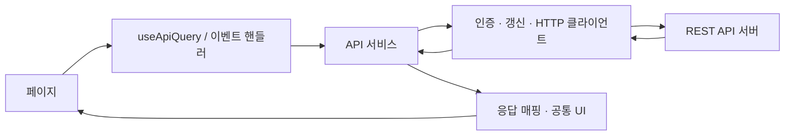
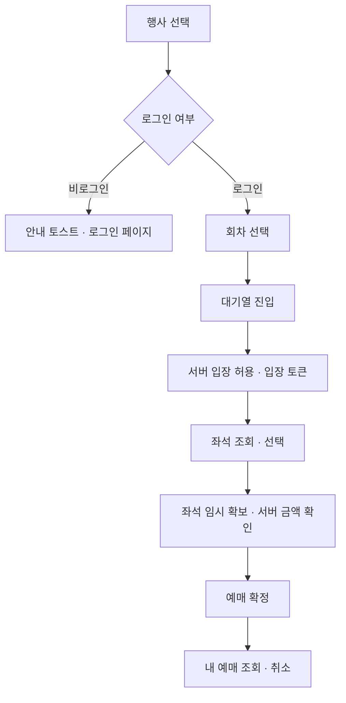

# TICKET BUY — 티켓 예매 서비스 데모

공연을 찾고, 회차를 선택하고, 대기열을 거쳐 좌석을 예매하는 과정을 구현한 **티켓 예매 웹 서비스의 프론트엔드 데모**입니다.

React와 TypeScript 기반 SPA로 구성되어 있으며, 별도 백엔드의 REST API와 연결합니다. 한국어·영어·중국어 간체, 라이트·다크 테마, 반응형 화면을 지원합니다.

> 학습 및 기능 검증을 위한 데모 프로젝트입니다. 실제 PG 결제는 연동하지 않았으며, 본사·회사·스폰서 정보 일부는 가상 디자인 데이터입니다. 대기열과 좌석 확보는 백엔드 API 응답으로 동작합니다.

## 주요 기능

| 영역 | 구현 기능 |
| --- | --- |
| 회원가입 | 아이디·이름·비밀번호 입력, 비밀번호 확인, 입력 조건 검증, 중복 아이디 안내 |
| 인증 | 로그인·로그아웃, 사용자명 표시, 갱신 쿠키를 이용한 세션 복원, 인증 만료 시 재시도 |
| 행사 탐색 | 행사 목록·상세, 장르 필터, 검색, 추천순·공연일순·가격순 정렬, 서버 페이지네이션 |
| 추천 행사 | 이미지 슬라이더, 자동 재생·일시정지, 이전·다음 및 키보드 이동 |
| 예매 대기열 | 회차별 진입, 서버 대기번호·앞선 대기자 수 표시, 폴링, 입장·취소 처리 |
| 좌석 선택 | 무대·좌석 배치, VIP·R·S 등급, 선택 가능 여부, 최대 4석 선택 |
| 예매 | 좌석 임시 확보·해제, 만료 시간 표시, 서버 금액 확인, 멱등 키를 이용한 예매 확정 |
| 내 예매 | Grid 기반 내역·상세 조회, 예매 취소, 빈 목록 안내 |
| 고객센터 | 서버 고객센터 안내, FAQ 검색·펼치기·페이지네이션 |
| 게시판 | 게시글 검색·목록·상세·페이지네이션 |
| 콘텐츠 관리 | 게시글·FAQ 등록·수정·삭제, 한국어·영어·중국어 콘텐츠 편집 |
| 공통 UI | 다국어, 테마 전환, 토스트, 중앙 정렬 팝업, 모바일 대응 |

로그인이 필요한 기능은 비로그인 접근 시 안내 토스트와 함께 로그인 페이지로 이동합니다. 고객센터 등 보호 경로는 로그인 후 원래 페이지로 돌아옵니다. 관리자 쓰기 권한은 서버에서 검증합니다.

## 기술 스택

| 구분 | 사용 기술 |
| --- | --- |
| UI | React 19 |
| 언어 | TypeScript 5.9 |
| 개발 서버·빌드 | Vite 8, React 플러그인 |
| 라우팅 | React Router 7 |
| 상태 관리 | React Context API, Hooks |
| HTTP | Fetch 기반 서비스 클라이언트, 공통 Axios 유틸리티 |
| 스타일 | CSS, CSS 변수 기반 테마, Tailwind CSS 4 |
| 다국어 | i18next, react-i18next |
| 아이콘·차트 | React Icons, Recharts |
| 코드 검사 | ESLint, TypeScript |
| 테스트 | Playwright, Node.js 내장 테스트 러너 |
| 패키지 관리 | pnpm |

## 화면 및 경로

| 경로 | 화면 | 로그인 필요 |
| --- | --- | --- |
| `/` | 행사 목록과 추천 행사 | 아니요 |
| `/sign-in` | 로그인 | 아니요 |
| `/sign-up` | 회원가입 | 아니요 |
| `/support` | 고객센터·FAQ | 예 |
| `/board` | 게시판 | 아니요 |
| `/reservations` | 내 예매 | 예 |
| `/admin` | 콘텐츠 관리 | 예 — 쓰기 작업은 관리자 권한 필요 |
| `/examples` | 공통 컴포넌트 예제 | 아니요 |

회차 선택·대기열·좌석 선택·예매 완료는 메인 페이지의 예매 팝업 흐름으로 제공합니다.

## 프로젝트 구조

```text
public/
└── images/                  # 추천 행사 배너 그래픽
src/
├── api/                     # 공통 HTTP·인증과 행사/대기열/좌석/예매/콘텐츠별 API
├── assets/                  # 공통 리소스 및 Tailwind 기본 스타일
├── components/
│   ├── auth/                # 로그인 접근 제어
│   ├── booking/             # 회차 선택, 대기열, 좌석 예매 팝업
│   ├── common/              # Grid, Pagination, Slider, SeatMap, Toast 등
│   └── layouts/             # Header, Footer
├── contexts/                # 인증·테마·토스트 Context
├── hooks/                   # 화면별 조회·예매·등록 상태와 공통 동작 훅
├── i18n/
│   └── locales/             # ko / en / zh-CN 번역 JSON
├── layouts/                 # 공통 페이지 레이아웃
├── mocks/                   # 이전 UI 및 번역 검증용 fixtures
├── pages/                   # 경로별 화면과 해당 화면의 children 컴포넌트
├── routes/                  # 경로 상수와 메뉴 메타 정보
├── styles/                  # 전역 스타일, 테마, 다크 모드·API 화면 스타일
├── types/interfaces/        # API·컴포넌트·페이지·Context별 인터페이스
├── utils/                   # 금액·날짜 등 공통 유틸리티
├── App.tsx                  # Provider 조합
├── AppRouter.tsx            # 라우트 구성
└── main.tsx                 # 앱 시작점과 전역 초기화
docs/                        # API 연동 문서
tests/                       # 다국어·브라우저 통합 테스트
```

### 데이터 흐름



- 페이지별 UI와 재사용 컴포넌트를 분리합니다.
- 타입은 `src/types/interfaces`에서 영역별로 관리합니다.
- 목록은 서버의 `items`, `total`, `page`, `pageSize` 응답을 사용합니다.
- API 조회 훅은 로딩·오류·재시도와 요청 취소를 처리합니다. StrictMode의 즉시 재구독에는 진행 중인 요청을 재사용합니다.
- accessToken은 메모리에 보관하고, refresh 쿠키를 포함해 인증을 갱신합니다. 비로그인 방문에는 갱신 요청을 보내지 않습니다.
- 화면에서 사용하는 행사 데이터는 실제 API 응답을 UI 구조로 매핑합니다. `mocks`는 서비스 화면의 데이터 소스로 사용하지 않습니다.

## 예매 흐름



대기열이 비어 있으면 서버 판단에 따라 바로 좌석 선택으로 이동합니다. 대기시간을 산정할 수 없는 경우 임의의 시간을 표시하지 않습니다. 예매 확정은 입장 토큰과 멱등 키를 전달하며, 실제 결제 API 없이 서버의 `NOT_REQUIRED` 결제 상태를 표시합니다.

## 로컬 실행

개발 검증 환경은 Node.js 24.x와 pnpm 11.x입니다. 이 저장소는 프론트엔드이며, 행사 조회·인증·예매 기능을 사용하려면 별도 백엔드를 실행해야 합니다.

```bash
pnpm install
pnpm dev
```

| 서비스 | 기본 주소 |
| --- | --- |
| 프론트엔드 | http://localhost:5173 |
| 백엔드 | http://localhost:8080 |
| Swagger UI | http://localhost:8080/swagger-ui/index.html |
| OpenAPI 명세 | http://localhost:8080/v3/api-docs |

개발 환경에서는 Vite가 `/api` 요청을 `http://localhost:8080`으로 프록시합니다. 기본 구성에서는 별도 환경변수 없이 사용할 수 있습니다.

다른 API 서버로 직접 연결하려면 `.env.example`을 참고해 `.env.local`을 만듭니다.

```dotenv
# API 경로(/api/v1)를 제외한 서버 origin
VITE_API_BASE_URL=http://localhost:8080
```

환경변수를 변경하면 개발 서버를 재시작합니다. 서버를 직접 호출하는 구성에서는 백엔드의 인증 쿠키 및 credentials CORS 정책도 맞춰야 합니다. 운영 배포에는 `/api` 리버스 프록시 또는 API 서버 환경변수를 설정합니다.

## VM 및 운영체제 환경

이 저장소에는 VM 생성 설정, 배포 스크립트, 컨테이너 설정이 포함되어 있지 않습니다. 따라서 프로젝트 코드만으로 운영 VM의 OS가 Rocky Linux, Ubuntu, Debian 또는 다른 배포판인지 확인할 수 없습니다. 운영체제는 배포 대상 VM에서 직접 확인해야 합니다.

VM에 접속해 다음 명령을 실행하면 배포판과 버전을 확인할 수 있습니다.

```bash
cat /etc/os-release
```

`ID` 또는 `PRETTY_NAME` 값으로 배포판을 판별합니다.

| `/etc/os-release` 값 예시 | 운영체제 |
| --- | --- |
| `ID=rocky` | Rocky Linux |
| `ID=ubuntu` | Ubuntu |
| `ID=debian` | Debian |

애플리케이션의 개발 검증 도구 버전은 Node.js 24.x와 pnpm 11.x입니다. 이는 VM의 OS나 운영 서버에 설치된 버전을 의미하지 않습니다. 실제 VM 정보를 확인한 뒤 운영체제와 런타임 버전을 배포 환경 문서에 별도로 기록하세요.

### VM과 Linux 배포판의 관계

VM은 가상 머신이고, Rocky Linux·Ubuntu·Debian은 VM에 설치할 수 있는 운영체제입니다. VM을 사용한다는 사실만으로 OS가 정해지지는 않습니다. VM 생성 시 선택한 이미지 또는 직접 설치한 OS를 기준으로 확인합니다.

| 구분 | Rocky Linux | Ubuntu | Debian |
| --- | --- | --- | --- |
| 배포판 계열 | RHEL 호환 계열 | Debian 계열 | Debian 계열 |
| 기본 패키지 관리 도구 | `dnf` | `apt` | `apt` |
| 설치 명령 형식 | `sudo dnf install <패키지>` | `sudo apt install <패키지>` | `sudo apt install <패키지>` |
| 배포 시 확인 사항 | SELinux 정책, 방화벽 설정, 패키지 저장소 | 방화벽 설정, 패키지 저장소 | 방화벽 설정, 패키지 저장소 |

위 명령은 형식 예시입니다. 패키지 이름과 제공 버전은 OS 버전 및 활성화된 저장소에 따라 다르므로, 설치 후 필요한 버전인지 확인합니다. 방화벽 도구와 보안 정책의 활성화 여부 역시 실제 VM 설정을 기준으로 확인합니다.

### 이 프론트엔드의 VM 배포 조건

이 프로젝트는 특정 Linux 배포판을 지정하지 않습니다. 다만 각 배포판에서의 운영 검증 결과는 이 저장소에 기록되어 있지 않습니다.

- **빌드 환경:** Node.js와 pnpm으로 `pnpm install`, `pnpm build`를 실행합니다. 현재 문서에 기록된 개발 검증 버전은 Node.js 24.x, pnpm 11.x입니다.
- **서비스 환경:** 빌드 결과인 `dist/`를 Nginx 같은 웹 서버로 제공합니다. 빌드를 다른 환경에서 수행하고 정적 파일만 VM에 배포한다면, 정적 파일 제공을 위해 VM에 Node.js와 pnpm을 설치할 필요는 없습니다.
- **페이지 경로:** `/sign-in`, `/reservations` 같은 SPA 경로를 직접 열거나 새로고침해도 동작하도록 웹 서버에 `index.html` fallback을 설정합니다.
- **API 연결:** 같은 주소를 사용한다면 웹 서버가 `/api` 요청을 백엔드로 전달해야 합니다. `vite.config.ts`의 프록시는 로컬 개발 서버용이며 운영 웹 서버에 자동으로 적용되지 않습니다.
- **환경변수:** API가 별도 주소라면 `.env.example`을 참고해 `VITE_API_BASE_URL`에 API origin을 지정한 뒤 빌드합니다. 이 값은 빌드 결과에 반영되므로 변경 후 다시 빌드해야 합니다.

### 실제 VM 정보 기록

아래 명령은 Linux VM 내부에서 실행합니다. `uname -r`은 커널 버전이며, 배포판 이름과 버전은 `/etc/os-release`로 확인합니다. Node.js와 pnpm 명령은 해당 VM에서 빌드하는 경우 확인합니다.

```bash
cat /etc/os-release
uname -r
uname -m
node --version
pnpm --version
```

| 기록 항목 | 현재 확인 상태 |
| --- | --- |
| VM 운영체제 및 버전 | 미확인 — VM의 `PRETTY_NAME`, `VERSION_ID`로 기록 |
| CPU 아키텍처 | 미확인 — `uname -m` 결과로 기록 |
| 커널 버전 | 미확인 — `uname -r` 결과로 기록 |
| VM 내 빌드 여부 | 미확인 — VM 빌드 또는 외부 빌드 후 `dist/` 배포 여부 기록 |
| VM의 Node.js / pnpm 버전 | 미확인 — VM에서 빌드하는 경우 기록 |
| 정적 파일 제공 웹 서버 | 미확인 — 실제 제품명과 버전 기록 |
| API 연결 방식 | 미확인 — `/api` 프록시 또는 별도 API origin 기록 |

## 명령어와 테스트

| 명령어 | 설명 |
| --- | --- |
| `pnpm dev` | 개발 서버 실행 |
| `pnpm typecheck` | TypeScript 타입 검사 |
| `pnpm lint` | 전체 ESLint 검사 |
| `pnpm test:i18n` | 번역 키·언어 저장·복원·문자 손상 검사 |
| `pnpm test:e2e` | API와 연결된 브라우저 통합 테스트 |
| `pnpm build` | 타입 검사 및 프로덕션 빌드 |
| `pnpm preview` | 빌드 결과 미리보기 |

브라우저 테스트는 Chrome과 실행 중인 백엔드가 필요합니다. 로그인·회원가입·목록 조회·예매·취소·관리자 CRUD·토큰 갱신·좌석 충돌 복구·빈 Grid 표시 등을 검증합니다. 테스트 계정과 데이터 생성·정리 정책은 [API 연동 문서](docs/API_INTEGRATION.md#검증)를 참고하세요.

## 데모 범위

- 실제 PG 결제, 운영 환경의 대규모 트래픽 성능 검증은 포함하지 않습니다.
- 대기열 및 좌석 동시성 제어의 최종 책임은 별도 백엔드에 있습니다.
- 고객센터 연락처가 서버에 없으면 서버 안내 문구를 표시합니다. 실제 상담 기능은 없습니다.
- 본사·회사·스폰서는 가상의 소개 디자인이며 실제 제휴를 의미하지 않습니다.
- 별도의 운영 배포 주소는 이 저장소에 포함하지 않습니다.

## 상세 문서

- [API 연동과 인증·예매 계약](docs/API_INTEGRATION.md)
- [소스 구조와 책임 분리](docs/ARCHITECTURE.md)
- [공통 HTTP 요청 유틸리티](src/api/README.md)
- [다국어 리소스 관리](src/i18n/README.md)
- [목 데이터 fixtures](src/mocks/README.md)

관리자 행사 등록과 포스터 업로드·표시 기능의 사용법 및 검증 방법은 [행사 등록 안내](docs/ADMIN_EVENTS.md)를 참고하세요. 관리자 등록 경로는 `/admin/events/new`입니다.
